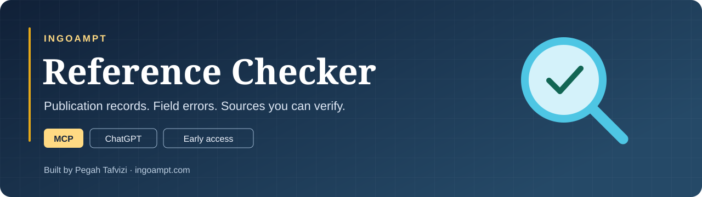

# INGOAMPT Reference Checker

**Check the citation. Open the evidence. Submit with more confidence.**

A **Model Context Protocol (MCP) integration for ChatGPT** that helps PhD students, supervisors, professors, and research groups review academic references. It compares citation details with a local DBLP snapshot, identifies supported field mismatches, and brings the evidence back into the conversation.

Built by **Pegah Tafvizi · INGOAMPT**.

**[Website & walkthrough](https://ingoampt.com/mcp-made-by-ingoampt/)** · **[Set up in ChatGPT](https://ingoampt.com/mcp-made-by-ingoampt/#mcs-setup)** · **[Live availability](https://ingoampt.com/mcp-made-by-ingoampt/#mcs-availability)** · **[Try the demo](https://ingoampt.com/mcp-made-by-ingoampt/#mcs-demo)**

## Why this exists

A reference can look convincing and still contain a wrong author, title, year, venue, or page range. AI-generated citations can also describe papers that cannot be verified. Finding a plausible title alone is not enough to check a bibliography.

INGOAMPT Reference Checker helps turn a list of references into **field-by-field findings with sources**. Its strongest fit is computer science conference and journal references.

## A public example: a real paper, a wrong year

The public demo includes BERT cited at NAACL-HLT with the year **2020**. The checker identifies a publication-year mismatch against the **2019 conference publication**.

| Report detail | Example |
| --- | --- |
| Paper | BERT: Pre-training of Deep Bidirectional Transformers for Language Understanding |
| Field | Publication year |
| Supplied value | 2020 |
| Supported correction | **2019** for the NAACL-HLT publication |
| Finding | `YEAR_MISMATCH` · `ERROR_INCORRECT` |
| Evidence | [DBLP conference record](https://dblp.org/rec/conf/naacl/DevlinCLT19.html) and [ACL Anthology proceedings](https://aclanthology.org/N19-1423/) |

This is a field-level worked example using a public paper. Preprint and conference versions are kept distinct, and the finding does not certify every field in the citation.

**[Run the two-reference demo in your own ChatGPT →](https://ingoampt.com/mcp-made-by-ingoampt/#mcs-demo)**

## How it works

1. **Connect the checker.** Add the hosted INGOAMPT MCP service to an eligible ChatGPT account or workspace using the illustrated setup guide.
2. **Start with local DBLP.** Submit your references in a chat. The checker searches INGOAMPT's stored DBLP snapshot and compares fields supported by the retrieved records.
3. **Follow up on uncertainty.** For an unresolved work or important field, the checker asks ChatGPT to use Search when available and consult a publisher, proceedings, or another authoritative source. Web findings are labeled separately from local DBLP findings.
4. **Review the evidence.** See the error type, supplied value, supported correction, source link, and any remaining uncertainty. Open the source before changing your bibliography.

[MCP](https://modelcontextprotocol.io/introduction) is the standard that lets an AI application call an external tool. Here, ChatGPT calls the INGOAMPT service to request checks and retrieve results. This repository documents that hosted integration; the connection guide on the website contains the current setup values.

### Selected MCP tools

| Tool | Purpose |
| --- | --- |
| `get_database_status` | Check service availability and snapshot readiness |
| `get_account_status` | Read the connected account's allowance |
| `check_references` | Submit a list for citation review |
| `get_reference_job` | Retrieve the connected account's temporary job result |

The service uses authenticated, account-owned jobs for reference checks. A submitted job must finish before it produces a bibliographic finding.

## What it can help check

| Citation field | Example of a supported finding |
| --- | --- |
| Title | Supplied title differs from the identified publication |
| Authors | A supplied author does not match the publication record |
| Year | Year conflicts with the identified publication version |
| Venue | Conference or journal conflicts with the record |
| Pages | Supplied range conflicts with the source's page range |

Coverage depends on the citation, the available source fields, and whether the publication version can be identified. A missing DBLP match **does not prove that a paper is fabricated**. Uncertain cases remain unresolved or need review. The checker does not establish whether a paper supports the claim for which it is cited.

## Try the early-access service

- **Use it inside ChatGPT.** The website is the product guide; reference submission happens in your chat.
- **Check availability first.** The local DBLP step runs on INGOAMPT's personal computer and needs the worker to be online. You do not download DBLP to your own computer.
- **Follow the setup guide.** Custom MCP access depends on your ChatGPT account or workspace. An INGOAMPT account is required to run checks, and service limits apply.
- **Arrange a time if needed.** If the worker is offline or checking is paused, email [email@ingoampt.com](mailto:email@ingoampt.com?subject=Reference%20Checker%20availability) with your time zone and preferred time. If the daily limit is full, use the reset information on the website.

This is an early-access custom MCP connection. There is currently no public ChatGPT directory listing or guaranteed around-the-clock availability.

## Privacy and scope of this repository

Adding the checker privately in ChatGPT does not publish your references. Running a check still sends the submitted citation details to INGOAMPT for processing. Jobs expire 15 minutes after submission; routine cleanup removes expired records. Separate usage counters remain, and ChatGPT follows its own conversation and data settings.

Read the **[Reference Checker privacy notice](https://ingoampt.com/mcp-made-by-ingoampt/#mcs-privacy)** before connecting or submitting references.

This public repository contains the product overview, a public worked example, and links to the service. **The server implementation, research datasets, private evaluation materials, credentials, and user submissions are not included.** Cloning the repository provides the showcase documentation rather than a self-hosted checker.

## Feedback and contact

Researchers and educators: tell us whether you could complete the demo, whether the source links made the correction easy to verify, and what would make the checker more useful for your next paper.

- [Suggest a product improvement](https://github.com/ingoampt/ingoampt-reference-checker/issues/new/choose).
- For connection, account, or data questions, email **[email@ingoampt.com](mailto:email@ingoampt.com?subject=INGOAMPT%20Reference%20Checker)**.
- GitHub feedback is public. Keep unpublished citations, private screenshots, account details, and credentials out of it.

---

**Developed by Pegah Tafvizi at [INGOAMPT](https://ingoampt.com/).**

DBLP supplies bibliographic evidence. OpenAI provides ChatGPT. This is an independent INGOAMPT project; no endorsement by those organizations is implied.
