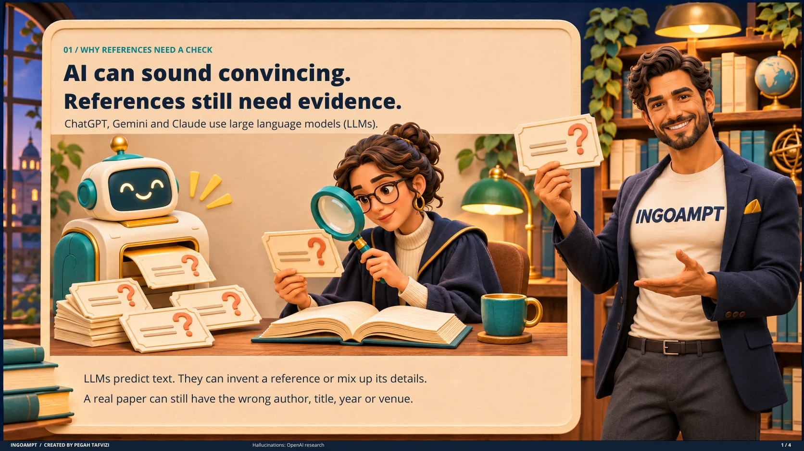
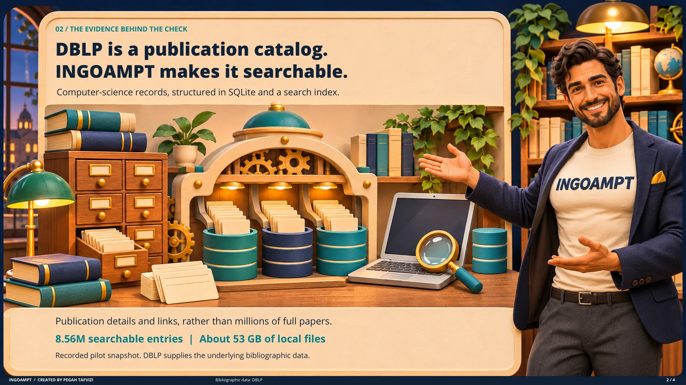
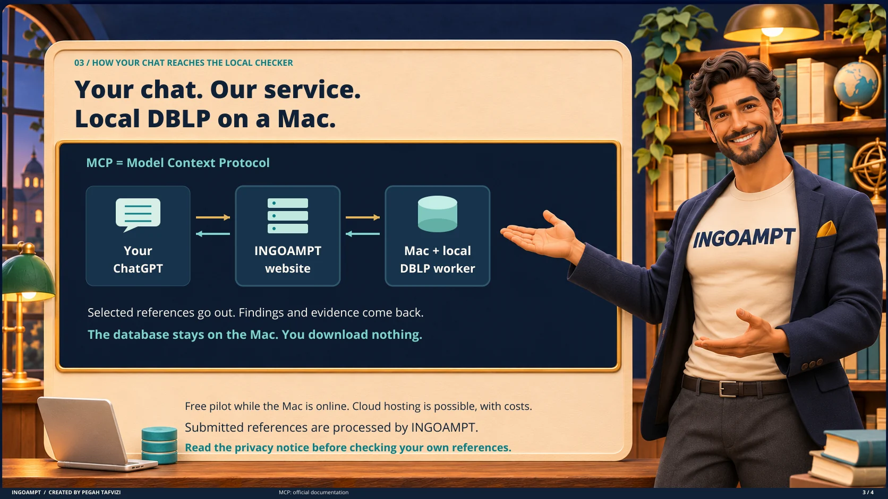
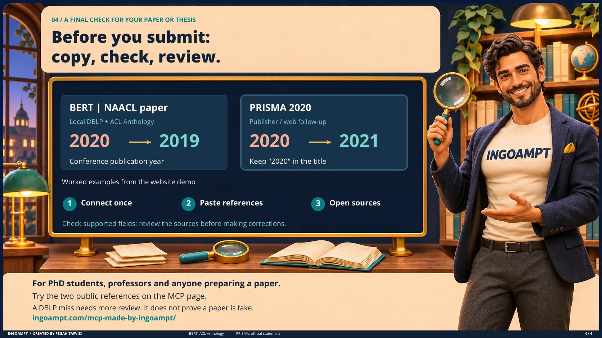

# INGOAMPT Reference Checker: the idea in four pictures

A short visual explanation by Pegah Tafvizi, using the same presenter and two-reference demo as the INGOAMPT website.

[Live setup, availability and demo](https://ingoampt.com/mcp-made-by-ingoampt/) · [Four-page PDF](INGOAMPT-Reference-Checker-Visual-Guide.pdf)

## 1. Why AI references need evidence

## 2. What DBLP contributes

The scale shown describes the recorded pilot snapshot, not live DBLP totals. DBLP supplies the underlying bibliography; INGOAMPT built the local checking workflow.

## 3. How the MCP connection works

[Read the privacy notice](https://ingoampt.com/mcp-made-by-ingoampt/#mcs-privacy). A private connection still sends submitted citation details to INGOAMPT for processing.

## 4. Try the public examples

BERT uses local DBLP evidence, supported by ACL Anthology. PRISMA uses publisher/web follow-up. These are worked examples, not a general accuracy claim. A DBLP miss alone does not establish that a paper is fabricated.

### Sources

- [OpenAI research on hallucinations](https://openai.com/index/why-language-models-hallucinate/)
- [What is DBLP?](https://dblp.org/faq/1474565.html)
- [Model Context Protocol](https://modelcontextprotocol.io/docs/getting-started/intro)
- [BERT conference publication](https://aclanthology.org/N19-1423/)
- [PRISMA 2020 statement](https://www.prisma-statement.org/prisma-2020-statement)

The public explainer contains no implementation code, research datasets, credentials or user submissions.
